

  <picture><source media="(prefers-color-scheme: dark)" srcset="assets/header-dark.svg"></picture>

 

I build tools for **Even Realities smart glasses**, native apps for **iPhone, iPad and Apple Watch**, and free learning resources. Most of what I make is open source, and everything is designed to run without accounts, ads or paid backends.

## Smart glasses

  <a href="https://github.com/gabrielevierti/glyph"><picture><source media="(prefers-color-scheme: dark)" srcset="assets/glyph-dark.svg"></picture></a>
  <a href="https://github.com/gabrielevierti/openg1-sdk"><picture><source media="(prefers-color-scheme: dark)" srcset="assets/openg1-sdk-dark.svg"></picture></a>

## On the App Store

  <a href="https://apps.apple.com/app/id6832491263"><picture><source media="(prefers-color-scheme: dark)" srcset="assets/quota-dark.svg"></picture></a>
  <a href="https://apps.apple.com/it/app/lineami/id6835143643?l=en-GB"><picture><source media="(prefers-color-scheme: dark)" srcset="assets/lineami-dark.svg"></picture></a>

## Graphics and games

  <a href="https://github.com/gabrielevierti/learnmetal"><picture><source media="(prefers-color-scheme: dark)" srcset="assets/learnmetal-dark.svg"></picture></a>
  <a href="https://github.com/gabrielevierti/learnmetal-engine"><picture><source media="(prefers-color-scheme: dark)" srcset="assets/learnmetal-engine-dark.svg"></picture></a>

## Open source

  <a href="https://github.com/gabrielevierti/metrica"><picture><source media="(prefers-color-scheme: dark)" srcset="assets/metrica-dark.svg"></picture></a>
  <a href="https://github.com/gabrielevierti/nodo"><picture><source media="(prefers-color-scheme: dark)" srcset="assets/nodo-dark.svg"></picture></a>

  <a href="https://www.arabodazero.it"><picture><source media="(prefers-color-scheme: dark)" srcset="assets/arabodazero-dark.svg"></picture></a>
  <a href="https://github.com/gabrielevierti/cetus-x-orb"><picture><source media="(prefers-color-scheme: dark)" srcset="assets/cetus-x-orb-dark.svg"></picture></a>

